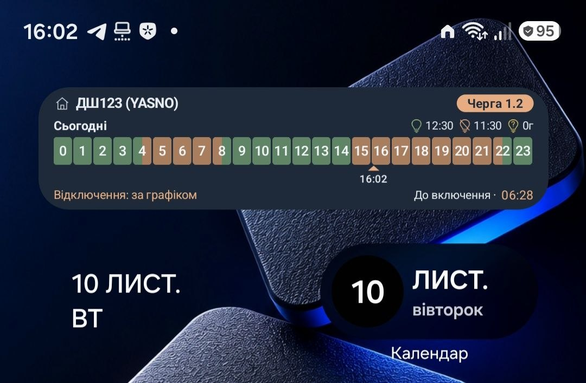

# Світло вдома 💡

Android-застосунок із віджетом графіків відключень електроенергії. Показує розклад на сьогодні та завтра, статус за графіком і час до наступного відключення або відновлення світла.

Інтерфейс українською мовою. Android 8.0 і новіші версії.




## Завантажити

**[Останній реліз і APK для встановлення](https://github.com/x404/svitlo-home/releases/latest)**

На сторінці релізу відкрийте **Assets** і завантажте файл із розширенням **`.apk`**. Архіви **Source code** призначені для розробників і не встановлюються на телефон як застосунок.

## Можливості

- Віджет із графіками на сьогодні та завтра.
- Компактний однорядковий режим із розкладом на сьогодні.
- Таймер до відключення або відновлення світла.
- Статистика часу зі світлом, без світла та можливих відключень.
- Відображення можливих відключень та відсутніх даних.
- Окремий екран **«Розклад і прогноз»** із подробицями та тижневим прогнозом YASNO.
- Перехід до потрібного дня натисканням на шкалу «Сьогодні» або «Завтра» у прев’ю віджета всередині застосунку.
- Виділення поточного інтервалу та приглушення завершених інтервалів у списку.
- Порівняння графіків ДТЕК і YASNO на спільній часовій шкалі.
- Вибір основного джерела та автоматичний резерв YASNO для ДТЕК.
- Швидка зміна спільної черги натисканням на плашку в прев’ю.
- Синхронізація черги з обраною адресою на сайті ДТЕК після підтвердження.
- Темна, світла та пісочна теми для застосунку й віджетів.
- Перевірка нових версій через GitHub Releases, завантаження APK та передача системному встановлювачу Android.
- Діагностика оновлень графіків з історією останніх 20 спроб і копіюванням звіту.

## Розклад і прогноз

Натисніть на сьогоднішню або завтрашню шкалу у верхньому прев’ю, щоб відкрити відповідний день на екрані **«Розклад і прогноз»**. Плашка «Черга» залишається окремою кнопкою зміни налаштувань.

На екрані подробиць:

- **Розклад** показує опубліковані інтервали на сьогодні та завтра.
- **Прогноз** показує тижневий прогноз YASNO. Він не є підтвердженим розкладом; відсутність можливого відключення не означає, що світло гарантовано буде.
- Поточний інтервал виділено м’яким фоном і кольоровою смужкою, завершені інтервали приглушено, майбутні мають звичайне оформлення.
- Заголовок і перемикач вкладок залишаються видимими під час прокручування.
- При поверненні зберігається позиція головної сторінки, а при повороті екрана — вибрана вкладка та прокручування подробиць.

Усі години відображаються за часовим поясом **Europe/Kyiv**.

## Джерела даних

**YASNO** надає графіки для обраного оператора електромереж. YASNO — джерело даних, а ДТЕК і ЦЕК — різні оператори з окремими графіками.

**Пряме отримання даних ДТЕК** підтримується для ДТЕК Дніпровські електромережі через офіційний сайт у вбудованому браузері. Доступність фонових оновлень залежить від роботи сайту та браузерної сесії. Іноді потрібне повторне відкриття сайту й ручне зчитування.

Якщо ДТЕК обрано основним джерелом, застосунок може тимчасово використовувати YASNO як резерв. Основне та фактичне джерела показуються окремо.

> Статус і таймер розраховуються за опублікованим графіком. Застосунок не вимірює напругу та не підтверджує фактичну наявність світла. Під час аварій або екстрених відключень розклад може не діяти.

Кольори шкали: зелений — світло за графіком, помаранчевий — відключення, жовтий — можливе відключення, сірий — немає даних. Невідомі години не вважаються відключеннями.

## Встановлення

1. Завантажте APK потрібної версії з розділу **[Releases](https://github.com/x404/svitlo-home/releases)**.
2. Дозвольте встановлення застосунків із цього джерела, якщо Android запропонує це зробити.
3. Встановіть APK та відкрийте «Світло вдома».
4. Укажіть назву дому, регіон, оператора й чергу.
5. Додайте віджет на головний екран через застосунок або меню віджетів Android.

Оновлення APK з тим самим підписом можна встановлювати поверх попередньої версії без видалення застосунку. Налаштування та віджети зберігаються.

## Оновлення застосунку

Починаючи з **0.3.6**, застосунок перевіряє нові стабільні релізи GitHub при відкритті — не частіше разу на добу. Перевірити вручну можна кнопкою **«Перевірити оновлення»** внизу головної сторінки.

Якщо знайдено новішу версію, з’явиться картка з переходом до опису змін. Довгий опис прокручується окремо від кнопок. Завантаження починається лише після натискання, показує прогрес і може бути скасоване.

Перед встановленням перевіряються розмір і SHA-256 файлу, пакет, підпис, версія та сумісність з Android. Саме встановлення підтверджується у системному вікні; за потреби Android попросить дозволити встановлення з «Світло вдома».

Автоматичного завантаження, тихого встановлення та фонових сповіщень про нові версії немає.

**Для вже встановленої 0.3.8:** оновлену збірку з `versionCode 30` потрібно встановити вручну поверх попередньої 0.3.8. Вбудований оновлятор порівнює номер версії та не пропонує повторно ту саму 0.3.8.

Якщо встановлено версію до 0.3.6, перше оновлення також потрібно виконати вручну.

## Зміна черги

Натисніть плашку черги у верхньому прев’ю, оберіть нове значення та натисніть **«Застосувати»**.

Зміна поширюється на застосунок і всі встановлені віджети. **Наразі підтримується один спільний профіль:** окремі черги для різних віджетів і одночасне порівняння кількох власних черг ще не реалізовані.

Якщо сайт ДТЕК визначить іншу чергу для обраної адреси, застосунок запропонує підтвердити її зміну. Скасування залишає налаштування без змін.

## Оновлення графіків і діагностика

Фонове оновлення заплановане приблизно кожні 15 хвилин за наявності мережі. Android і енергозбереження Samsung можуть затримувати його; це не гарантія запуску рівно раз на 15 хвилин.

Відкриття застосунку запускає оновлення даних. Також доступна ручна кнопка **«Оновити»**.

Якщо графік не оновлюється, відкрийте **«Оновлення» → «Діагностика»**. Там доступні:

- остання зафіксована фонова спроба та час успішного отримання;
- поточний стан мережі та задач фонового оновлення;
- історія останніх 20 спроб: фонових, ручних і при відкритті застосунку;
- результат, джерело даних і використання резерву YASNO;
- кнопка **«Скопіювати діагностику»**.

Історія зберігається локально та починає збиратися після встановлення версії з діагностикою. Адреси, cookies та сирі відповіді сервера до звіту не потрапляють; автоматично він нікуди не надсилається.

Незавершений запис може означати, що запит ще триває або Android завершив процес. Діагностика допомагає шукати причину, але сама по собі не доводить, чому система затримала запуск.

## Технології

- Kotlin
- Jetpack Compose
- RemoteViews
- WorkManager
- WebView

## Збирання

Потрібні JDK 17 і Android SDK 35.

```bash
./gradlew assembleDebug
```

Готовий APK:

```text
app/build/outputs/apk/debug/app-debug.apk
```

Перевірки:

```bash
./gradlew testDebugUnitTest lintDebug
```

Для встановлення власної збірки поверх опублікованої потрібен той самий ключ підпису. Автоматично створений debug-ключ іншого комп’ютера не підійде. Приватний ключ не входить до вихідного коду та не повинен публікуватися в репозиторії.

## Поточна версія

**0.3.8 · versionCode 30**

Вигляд і розміри віджета можуть залежати від пристрою, масштабу шрифту та налаштувань головного екрана.

## Незалежний проєкт

«Світло вдома» — незалежний застосунок, який не є офіційним продуктом ДТЕК або YASNO.
