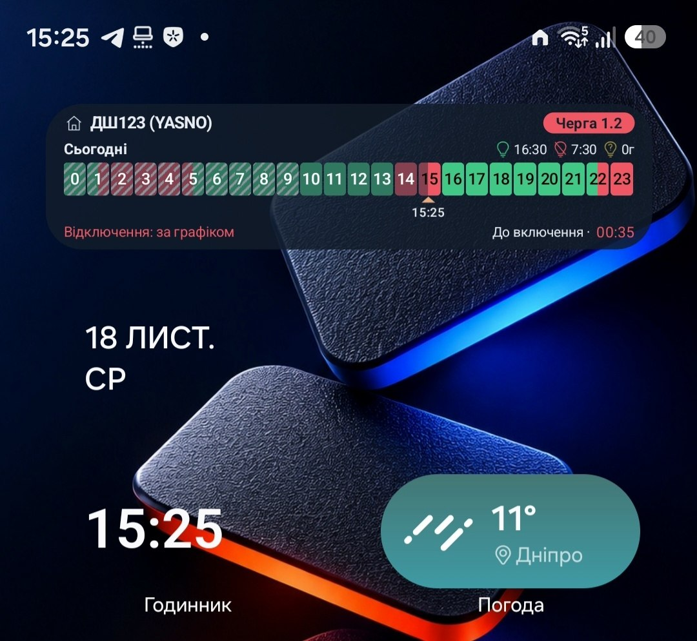
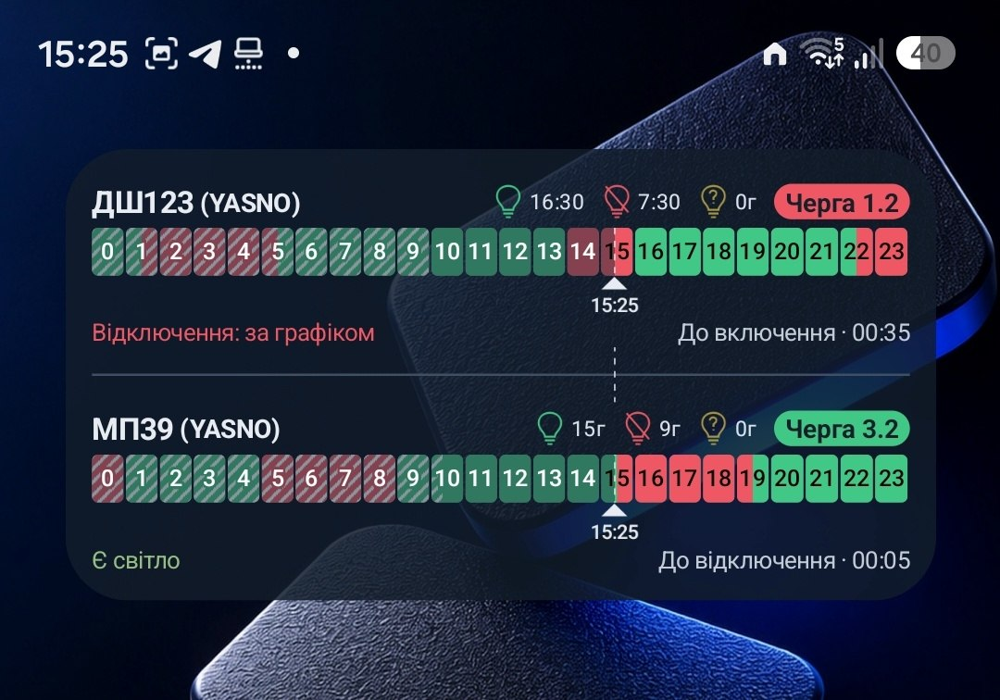

# Світло вдома 💡

Android-застосунок із віджетами графіків відключень електроенергії. Допомагає стежити за розкладом для дому, роботи та інших об’єктів: показує графіки на сьогодні й завтра, розрахунковий статус, час до зміни електропостачання та відомі позапланові події.

**Інтерфейс українською · Android 8.0+ · Версія 0.4.8 / versionCode 39**


## Завантажити

**[Останній опублікований реліз і APK для встановлення](https://github.com/x404/svitlo-home/releases/latest)**

На сторінці релізу відкрийте **Assets** та завантажте файл із розширенням **`.apk`**. Архіви **Source code** і `*-source.zip` містять вихідний код та не встановлюються на телефон як застосунок.

## Приклади віджетів

**Один об’єкт**



**Кілька об’єктів**



Вигляд і доступний розмір залежать від лаунчера, масштабу шрифту та налаштувань домашнього екрана.

## Можливості

- До **трьох об’єктів** із власними назвами, операторами, чергами та вибраними джерелами графіків.
- Відображення одного або кількох об’єктів у застосунку та віджетах.
- Одиночний віджет із графіками на сьогодні й завтра та компактний однорядковий режим на сьогодні.
- Спільний віджет для кількох об’єктів із вибором сьогоднішнього або завтрашнього графіка.
- Статус за графіком, позначка поточного часу та відлік до відключення або відновлення світла.
- Фактичне джерело графіка біля назви об’єкта, зокрема при використанні резерву.
- Позапланові відключення й аварійні ремонтні роботи, якщо для об’єкта доступні оперативні відомості.
- **«Статистика за день»** в окремій картці кожного об’єкта: планові години та відома тривалість позапланових подій.
- **«Повідомлення»**, згруповані за об’єктами: події, офіційні попередження та зрозумілі пояснення проблем оновлення.
- Екран **«Розклад і прогноз»** із подробицями та тижневим прогнозом YASNO.
- Порівняння графіків ДТЕК і YASNO на спільній часовій шкалі.
- Швидка зміна черги та джерела даних без відкриття повної форми редагування.
- Перетягування карток для зміни порядку об’єктів і видалення з підтвердженням.
- Темна, світла та пісочна теми застосунку. Віджети мають темне напівпрозоре тло з контрастними написами.
- Перевірка нових версій через GitHub Releases, завантаження APK та передача системному встановлювачу Android.
- Діагностика оновлень з історією останніх 20 спроб і копіюванням звіту.

## Встановлення та перший запуск

1. Завантажте APK з розділу **[Releases](https://github.com/x404/svitlo-home/releases)**.
2. Дозвольте встановлення застосунків із цього джерела, якщо Android запропонує це зробити.
3. Встановіть APK та відкрийте «Світло вдома».
4. На сторінці **«Додати об’єкт»** укажіть назву, регіон, оператора електромереж і чергу. Чергу перевірте на сайті свого оператора.
5. Натисніть **«Додати об’єкт»**.
6. Додайте віджет через кнопку **«Додати віджет»** у застосунку або меню віджетів Android.

Оновлення з тим самим підписом можна встановлювати поверх попередньої версії без видалення застосунку. Налаштування та об’єкти зберігаються.

## Мої об’єкти

На головній сторінці натисніть значок налаштувань, щоб відкрити **«Мої об’єкти»**.

- Додайте до трьох об’єктів, наприклад дім, роботу та житло рідних.
- Увімкніть **«Кілька об’єктів»**, щоб бачити їхні графіки разом. У режимі одного об’єкта виберіть потрібний зі списку.
- Перетягніть картку за спеціальний значок, щоб змінити порядок. Під час руху вона трохи темніша та прозоріша.
- Натисніть плашку **«Черга»**, щоб швидко змінити чергу саме цього об’єкта.
- Скористайтеся полем **«Джерело даних»**, щоб вибрати YASNO або підключити ДТЕК, якщо він підтримується.
- Натисніть **«Редагувати об’єкт»**, щоб змінити назву та параметри електропостачання. Підтвердження — **«Зберегти зміни»**.
- Для видалення утримуйте картку й підтвердьте дію в нижньому вікні кнопкою **«Так»**. **«Ні»** скасовує видалення.

Режим відображення застосунку та налаштування кожного віджета зберігаються окремо. Зміна черги конкретного об’єкта поширюється на всі віджети, які його показують.

Оформлення вибирається в спільній секції **«Оформлення»**.

## Віджети та часові шкали

Біля назви кожного об’єкта показано джерело графіка, наприклад **«ДШ123 (YASNO)»** або **«МП39 (ДТЕК)»**.

| Колір | Значення за графіком |
|---|---|
| 🟩 Зелений | Є світло |
| 🟥 Червоний | Відключення |
| 🟨 Жовтий | Можливе відключення |
| ⬜ Сірий | Немає даних |

Плашки черги та лампочки використовують базові кольори відповідних станів. Три значення біля лампочок — це тривалість станів за **весь вибраний день**, а не лише час, що залишився. При неповному графіку замість непідтверджених підсумків показуються прочерки.

Штриховка позначає відомі інтервали позапланових робіт або відключень. Вона не змінює базовий графік. Актуальна позапланова подія виділяється жовтим; під шкалою залишається коротка назва, а пояснення — у **«Повідомленнях»**.

На **«Завтра»** немає поточного статусу електропостачання, сьогоднішнього відліку та аварій сьогодні. Якщо завтрашній графік відсутній, застосунок повідомляє, що його ще не опубліковано.

Віджети мають темний фон без рамки з непрозорістю близько **85%**. Написи та шкали залишаються повністю непрозорими. Справжнє розмиття шпалер не використовується.

Якщо після зміни кількості об’єктів віджет займає зайві клітинки, зменште його рамку засобами лаунчера. Зайняту сітку домашнього екрана визначає Android-лаунчер.

Натискання віджета домашнього екрана відкриває застосунок. Плашка черги у віджеті відкриває його налаштування; у прев’ю всередині застосунку вона дозволяє змінити чергу об’єкта.

Усі години відображаються за часовим поясом **Europe/Kyiv**.

## Розклад, прогноз і порівняння

Натисніть шкалу в прев’ю всередині застосунку, щоб відкрити екран **«Розклад і прогноз»** для потрібного об’єкта та дня.

- **«Розклад»** показує опубліковані інтервали. Поточний інтервал виділено, завершені — приглушено.
- **«Прогноз»** показує тижневий прогноз YASNO. Це не підтверджений розклад: відсутність позначки можливого відключення не гарантує світло.
- **«Порівняти графіки»** дозволяє зіставити ДТЕК та YASNO. Перегляд порівняння сам по собі не змінює вибране джерело даних.

## Джерела даних

### Графіки

**YASNO** надає графіки для обраного оператора електромереж. YASNO — джерело даних, а ДТЕК і ЦЕК — різні оператори з окремими розкладами.

**Пряме отримання даних ДТЕК** підтримується для ДТЕК Дніпровські електромережі через офіційний сайт у вбудованому браузері. Для підключення потрібно вибрати й перевірити адресу та чергу. Доступність оновлень залежить від роботи сайту та браузерної сесії; іноді потрібне повторне відкриття сайту й зчитування.

Для кожного об’єкта джерело вибирається окремо в полі **«Джерело даних»** — на головній сторінці в секції **«Об’єкт»** або в його картці на сторінці **«Мої об’єкти»**.

При недоступності ДТЕК застосунок може показати резервний графік YASNO. Біля назви об’єкта вказується фактичне джерело показаного графіка.

### Позапланові події

Оперативні відомості про аварійні ремонтні роботи та екстрені відключення надходять окремо з **[dnipro-svitlo.com.ua](https://dnipro-svitlo.com.ua/)** для підтримуваних черг ДТЕК у Дніпрі. Це доповнення до графіка; його доступність та актуальність перевіряються окремо.

> Статус і таймер розраховуються за графіком. Застосунок не вимірює напругу та не підтверджує фактичну наявність світла. Під час аварій або екстрених відключень розклад може не діяти.

Пояснення про графік, джерело та штриховку доступні за кнопкою **ⓘ** біля заголовка **«Об’єкт»**. Інформація про вибір джерел також доступна через ⓘ у секції **«Електропостачання»** форми об’єкта.

## Статистика за день

Кожен об’єкт має окрему картку з назвою, чергою та двома групами даних.

**«Графік на сьогодні» / «Графік на завтра»** — тривалість планових станів за весь вибраний день:

- зі світлом;
- відключення;
- можливі відключення;
- без даних.

**«Позапланові відключення»** — відома тривалість аварійних ремонтних робіт, екстрених та інших подій до поточного моменту. Ця група відображається лише для сьогоднішнього дня.

**«Загальна тривалість»** — підсумок відомих позапланових інтервалів. Перетини враховуються один раз, тому підсумок може бути меншим за суму окремих категорій. Планові години до нього не додаються.

Оперативне джерело не гарантує повної історії за добу, тому використовується позначка **«Дані неповні»**. Відсутність відомостей не видається за нуль годин. Це не вимірювання фактичної тривалості відсутності світла.

## Оновлення даних і діагностика

Фонове оновлення заплановане приблизно кожні **15 хвилин** за наявності мережі. Android та енергозбереження Samsung можуть затримувати його; точний інтервал не гарантується.

Відкриття застосунку запускає оновлення. Ручне оновлення — кнопка **«Оновити дані»**. Під час запиту її напис змінюється на **«Оновлюємо…»**. Повторні запити також залежать від обмежень відповідного джерела.

Якщо отримати новий графік не вдалося, застосунок пояснює, чи показано збережені дані. Статус і відлік за таким графіком можуть бути неточними.

**«Діагностика»** доступна з блоку повідомлень або секції оновлення. Вона показує:

- останню зафіксовану фонову спробу та час успішного отримання;
- стан мережі та задач фонового оновлення;
- історію останніх 20 спроб, їх результат і джерело;
- використання резерву та доступні технічні подробиці помилки.

Історія зберігається локально. Звіт можна переглянути та скопіювати кнопкою **«Скопіювати діагностику»**; автоматично він нікуди не надсилається.

Незавершений запис може означати, що запит ще триває або Android завершив процес. Сам по собі він не доводить причину затримки.

## Оновлення застосунку

Застосунок перевіряє нові стабільні релізи GitHub при відкритті — не частіше разу на добу. Перевірити вручну можна кнопкою **«Перевірити оновлення»** внизу головної сторінки.

Якщо доступна новіша версія, з’являється окремий блок із переходом до опису змін. Завантаження APK починається лише після натискання, показує прогрес і може бути скасоване.

Перед встановленням перевіряються розмір і SHA-256 файлу, пакет, підпис, версія та сумісність з Android. Встановлення підтверджується в системному вікні; за потреби Android попросить дозволити встановлення з «Світло вдома».

Автоматичного завантаження, тихого встановлення та фонових сповіщень про нові версії немає. Якщо ваша стара версія не має вбудованого оновлювача, завантажте APK вручну з **Releases**.

## Для розробників

Застосунок використовує **Kotlin, Jetpack Compose, RemoteViews, WorkManager та WebView**.

Для складання потрібні повний Android-проєкт, **JDK 17**, **Android SDK 35** та Gradle wrapper із проєкту. Вихідний код може бути доступний у репозиторії або окремому архіві відповідного релізу.

```bash
./gradlew :app:assembleDebug
```

Готовий APK:

```text
app/build/outputs/apk/debug/app-debug.apk
```

Перевірки:

```bash
./gradlew :app:testDebugUnitTest :app:lintDebug
```

Поточна конфігурація не створює новий ключ підпису автоматично. Для встановлюваної збірки передайте через захищене локальне оточення `SVITLO_KEYSTORE`, `SVITLO_KEY_ALIAS`, `SVITLO_STORE_PASSWORD` та `SVITLO_KEY_PASSWORD`.

Для встановлення власної збірки поверх раніше встановленої потрібен той самий підпис. Приватні ключі, паролі та браузерні cookies не повинні публікуватися в репозиторії.

## Розробник і підтримка

Підтримати розвиток можна через **[банку monobank](https://send.monobank.ua/jar/5N3myz8r19)**. Підтримка добровільна; застосунок залишається безкоштовним.

## Незалежний проєкт

«Світло вдома» — незалежний застосунок, який не є офіційним продуктом ДТЕК або YASNO.
